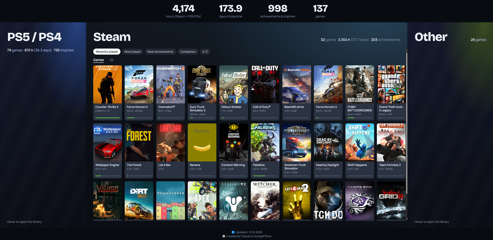

# 🎮 My Games Stats

## English

### 📜 Description
My Games Stats is a small static website that shows everything you have played: total hours, days of playtime, achievements and trophies across Steam, PS5 / PS4, PS3, PS2, Xbox 360, PSP and PC. Cover art, sorting and a light/dark theme included. No more "so what have you actually played?" – just open the page.

Live preview: [https://orangep1llow.github.io/WEB-played-games-aggregator/](https://orangep1llow.github.io/WEB-played-games-aggregator/)

### 🎮 Features
- **Totals at a glance** – Big numbers for hours, days of playtime, achievements & trophies and number of games.
- **Steam & PS5 / PS4** – Playtime, achievements / trophies, a completion bar and cover art for every game.
- **Other Panel** – Xbox 360, PS3, PS2, PSP and PC (non-Steam) in tabs. These are hand-written lists; PS3 titles are also could be picked up from PSN.
- **Sorting** – Recently played, most played, most achievements / trophies, completion and A–Z.
- **Show All** – The first 30 games are shown, the rest opens with one click.
- **Responsive Design** – Panels open on hover on desktop, with Tab on a keyboard and on tap on phones.
- **Light & Dark Theme** – Switches automatically based on your system settings.
- **No Backend** – A Node.js script generates the data, the page itself is plain HTML / CSS / JS.

### 📜 Usage
- **Open a panel** – Hover over it (desktop), press Tab (keyboard) or tap it (phone)
- **Sort games** – Buttons above the cards in the Steam and PS5 / PS4 panels
- **See the whole library** – "Show all games" button under the cards
- **Switch platform in the Other panel** – Tabs at the top of the panel
- **Add Xbox 360 / PS3 / PS2 / PSP / PC games** – Edit the lists in `manual.js`
- **Refresh the data** – Run `node fetch.js` again

### ⚙️ How It Works
`fetch.js` runs on your own computer, asks Steam and PlayStation for your data, downloads cover art and writes `stats.js`. `index.html` reads `stats.js` and `manual.js` and renders everything, so your keys never leave your machine. Hours and days count Steam and PS5 / PS4 only (the Other panel is plain lists), and days are simply hours divided by 24.

### 🛠️ Installation
Requirements: [Node.js](https://nodejs.org) 18 or newer.

1. Copy `config.example.json` to `config.json`.
2. **Steam:** get a free API key at <https://steamcommunity.com/dev/apikey>, put it and your SteamID64 into `config.json`, and set *My profile* and *Game details* to **Public** in Steam privacy settings.
3. **PlayStation (optional):** run `npm install psn-api`, sign in at <https://www.playstation.com>, open <https://ca.account.sony.com/api/v1/ssocookie> in the same browser and copy the `npsso` value into `config.json` as `psnNpsso`. It expires after about two months.
4. Run `node fetch.js`, then open `index.html` in your browser.

### 🔒 Privacy & Safety
- Never share `config.json`. If it ever leaks, regenerate the Steam API key and change your PSN password.
- Everything on GitHub Pages is public: your games, hours and covers.
- PlayStation data comes from the unofficial `psn-api` library and may break if Sony changes something. Play time is only available for some PS4 / PS5 games, and media apps are ignored.
- Steam only lists games that have recorded playtime.
- Not affiliated with Valve, Sony or Microsoft. Game names and covers belong to their owners.

### 📧 Credits
- Developer: StanisLove
- Data from: Steam Web API, [psn-api](https://github.com/achievements-app/psn-api)
- Vibe-coded with: Claude (Anthropic) – yes, an AI wrote most of it, and we're not hiding it 😄

---

## Українська

### 📜 Опис
My Games Stats – це маленький статичний сайт, який показує все, у що ви грали: загальні години, дні гри, ачівки та трофеї зі Steam, PS5 / PS4, PS3, PS2, Xbox 360, PSP і PC. Є обкладинки, сортування та світла/темна тема. Більше не треба питати «а в що ти взагалі грав?» – достатньо відкрити сторінку.

Живий приклад: [https://orangep1llow.github.io/WEB-played-games-aggregator/](https://orangep1llow.github.io/WEB-played-games-aggregator/)

### 🎮 Функції
- **Підсумки одразу** – Великі цифри: години, дні гри, ачівки з трофеями та кількість ігор.
- **Steam і PS5 / PS4** – Час гри, ачівки / трофеї, смужка проходження та обкладинка кожної гри.
- **Панель Other** – Xbox 360, PS3, PS2, PSP і PC (не зі Steam) у вкладках. Це списки вручну; PS3-ігри також підтягуються з PSN.
- **Сортування** – Нещодавно зіграні, найбільше часу, найбільше ачівок / трофеїв, проходження та А–Я.
- **Показати все** – Спочатку 30 ігор, решта відкривається одним кліком.
- **Адаптивний дизайн** – Панелі відкриваються наведенням на комп'ютері, клавішею Tab на клавіатурі й тапом на телефоні.
- **Світла й темна тема** – Перемикається автоматично за системними налаштуваннями.
- **Без бекенду** – Дані генерує скрипт на Node.js, а сама сторінка це звичайні HTML / CSS / JS.

### 📜 Використання
- **Відкрити панель** – Наведіть курсор (комп'ютер), натисніть Tab (клавіатура) або торкніться (телефон)
- **Відсортувати ігри** – Кнопки над картками в панелях Steam і PS5 / PS4
- **Побачити всю бібліотеку** – Кнопка «Show all games» під картками
- **Змінити платформу в панелі Other** – Вкладки вгорі панелі
- **Додати ігри Xbox 360 / PS3 / PS2 / PSP / PC** – Змініть списки в `manual.js`
- **Оновити дані** – Знову запустіть `node fetch.js`

### ⚙️ Як це працює
`fetch.js` запускається на вашому комп'ютері, питає у Steam і PlayStation ваші дані, завантажує обкладинки та записує `stats.js`. `index.html` читає `stats.js` і `manual.js` та малює все на сторінці, тому ваші ключі ніколи не залишають ваш комп'ютер. Години й дні рахуються лише для Steam і PS5 / PS4 (панель Other це прості списки), а дні це просто години, поділені на 24.

### 🛠️ Встановлення
Потрібен [Node.js](https://nodejs.org) 18 або новіший.

1. Скопіюйте `config.example.json` у `config.json`.
2. **Steam:** отримайте безкоштовний API-ключ на <https://steamcommunity.com/dev/apikey>, вставте його та свій SteamID64 у `config.json` і зробіть «Мій профіль» та «Відомості про гру» **публічними** в налаштуваннях приватності Steam.
3. **PlayStation (за бажанням):** виконайте `npm install psn-api`, увійдіть на <https://www.playstation.com>, у тому ж браузері відкрийте <https://ca.account.sony.com/api/v1/ssocookie> і скопіюйте значення `npsso` у `config.json` як `psnNpsso`. Воно діє приблизно два місяці.
4. Запустіть `node fetch.js`, а потім відкрийте `index.html` у браузері.

### 🔒 Приватність і безпека
- Ніколи не поширюйте `config.json`. Якщо він раптом потрапив у репозиторій, перегенеруйте Steam API-ключ і змініть пароль PSN.
- Усе на GitHub Pages публічне: ваші ігри, години та обкладинки.
- Дані PlayStation беруться з неофіційної бібліотеки `psn-api` і можуть перестати працювати, якщо Sony щось змінить. Час гри доступний лише для частини ігор PS4 / PS5, а медіа-застосунки ігноруються.
- Steam показує лише ігри із записаним часом гри.
- Проєкт не пов'язаний з Valve, Sony чи Microsoft. Назви ігор і обкладинки належать їхнім власникам.

### 📧 Автори
- Розробник: StanisLove
- Дані: Steam Web API, [psn-api](https://github.com/achievements-app/psn-api)
- Навайбкоджено разом з: Claude (Anthropic) – так, більшість коду написав ШІ, і ми цього не приховуємо 😄